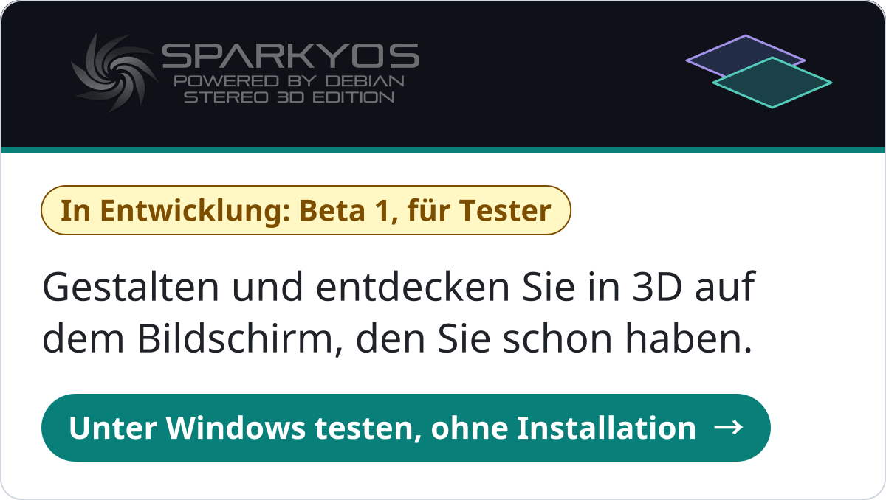

<picture>
  <source media="(prefers-color-scheme: dark)" srcset="./assets/banner-dark.svg">
  <source media="(prefers-color-scheme: light)" srcset="./assets/banner-light.svg">
  
</picture>

🇨🇦 [English](https://github.com/Sparky-OS) · 🇧🇷 [Português](https://github.com/Sparky-OS/.github/blob/main/profile/README.pt-BR.md) · 🇵🇱 [Polski](https://github.com/Sparky-OS/.github/blob/main/profile/README.pl.md) · 🇫🇷 [Français](https://github.com/Sparky-OS/.github/blob/main/profile/README.fr.md) · 🇩🇪 [Deutsch](https://github.com/Sparky-OS/.github/blob/main/profile/README.de.md) · 🇲🇽 [Español](https://github.com/Sparky-OS/.github/blob/main/profile/README.es.md) · 🇯🇵 [日本語](https://github.com/Sparky-OS/.github/blob/main/profile/README.ja.md) · 🇰🇷 [한국어](https://github.com/Sparky-OS/.github/blob/main/profile/README.ko.md) · 🇨🇳 [简体中文](https://github.com/Sparky-OS/.github/blob/main/profile/README.zh-CN.md) · 🇭🇰 [繁體中文](https://github.com/Sparky-OS/.github/blob/main/profile/README.zh-TW.md)

# Sparky-OS

**Drei Linux-Systeme, die einander ergänzen: eines läuft von einem USB-Stick, den Sie bei sich tragen, eines zeigt Ihren Desktop, Filme und Spiele in 3D auf dem Bildschirm, den Sie schon haben, und eines ist für kleine Unternehmen.**
Gemacht von Paweł "pavroo" Pijanowski, dem Schöpfer von SparkyLinux, und Daniel Ramos.

## SparkyOS onUSB

<a href="https://sparkyos.sparkylinux.org/">
<picture>
  <source media="(prefers-color-scheme: dark)" srcset="./assets/cards/onusb-de-dark.svg">
  <source media="(prefers-color-scheme: light)" srcset="./assets/cards/onusb-de-light.svg">
  
</picture>
</a>

Das ganze System läuft vom USB-Stick und wird aktualisiert wie ein auf einer Festplatte installiertes System; auf dem Computer wird nichts installiert.
Es gibt zwei Editionen, eine auf Basis von Arch Linux und eine auf Basis von Debian, beide mit dem schlanken Xfce-Desktop, für 64-Bit-PCs.
Von Paweł "pavroo" Pijanowski und dem SparkyLinux-Team (Website auf Englisch): [seine Startseite](https://sparkyos.sparkylinux.org/) · [Download](https://sparkyos.sparkylinux.org/download/) · [Anleitungen (How-To)](https://sparkyos.sparkylinux.org/how-to/)

## Sparky Stereo OS

<a href="https://github.com/Sparky-OS/sparky-stereo-os/issues/153">
<picture>
  <source media="(prefers-color-scheme: dark)" srcset="./assets/cards/stereo-de-dark.svg">
  <source media="(prefers-color-scheme: light)" srcset="./assets/cards/stereo-de-light.svg">
  
</picture>
</a>

Malen, Fotos und Videos bearbeiten, Moleküle und Globen erkunden, dann Filme ansehen und spielen.
Es ist für jede Art von 3D-Bildschirm gemacht: 3D-Fernseher und 3D-Projektoren, VR-Headsets, brillenlose 3D-Displays und jeden Monitor mit einer Rot-Cyan-Brille.
Auf einem gewöhnlichen 2D-Monitor funktioniert derselbe Desktop ohne jede Änderung.

 

*Mit einer Rot-Cyan-Brille erscheinen diese Bilder in 3D ([mehr](https://github.com/Sparky-OS/sparky-stereo-os/blob/main/docs/edition-in-detail.md#seen-in-3d)).*

Sparky Stereo OS, Daniel Ramos' Edition von SparkyLinux (von Paweł "pavroo" Pijanowski), ist ein Linux-System mit einem neuen Stereo-KDE-Plasma-Desktop.
Getestet auf 3D-Fernsehern, auf gewöhnlichen Monitoren mit Rot-Cyan-Brille und auf einem Android-Telefon in einem preiswerten Betrachter; brillenlose Displays und eigenständige Headsets sind in Arbeit.

**Die Entwickler-ISO ist für Entwickler und wird auf Anfrage verschickt:** Fragen Sie danach und erzählen Sie uns von Ihrer 3D-Ausrüstung, in Ihrer Sprache: [🇨🇦](https://github.com/Sparky-OS/sparky-stereo-os/issues/26) [🇧🇷](https://github.com/Sparky-OS/sparky-stereo-os/issues/25) [🇵🇱](https://github.com/Sparky-OS/sparky-stereo-os/issues/27) [🇫🇷](https://github.com/Sparky-OS/sparky-stereo-os/issues/80) [🇩🇪](https://github.com/Sparky-OS/sparky-stereo-os/issues/153) [🇲🇽](https://github.com/Sparky-OS/sparky-stereo-os/issues/351) [🇯🇵](https://github.com/Sparky-OS/sparky-stereo-os/issues/81) [🇰🇷](https://github.com/Sparky-OS/sparky-stereo-os/issues/83) [🇨🇳](https://github.com/Sparky-OS/sparky-stereo-os/issues/84) [🇭🇰](https://github.com/Sparky-OS/sparky-stereo-os/issues/85)

**Mehr:** [die Edition](https://github.com/Sparky-OS/sparky-stereo-os/blob/main/README.de.md) · [eine Anleitung zum Ausprobieren unter Windows](https://github.com/Sparky-OS/sparky-stereo-os/blob/main/docs/guides/try-on-windows.de.md) · auf Englisch: [was gebaut ist, im Detail](https://github.com/Sparky-OS/.github/blob/main/profile/in-detail.md#sparky-stereo-os) · [wie sie gebaut ist](https://github.com/Sparky-OS/sparky-stereo-os/blob/main/docs/architectural-synthesis.md) · [unsere Forks](https://github.com/Sparky-OS/.github/blob/main/profile/in-detail.md#repositories)

## Sparky Business: Server und Client

<a href="https://github.com/Sparky-OS/.github/blob/main/profile/in-detail.md#business-editions">
<picture>
  <source media="(prefers-color-scheme: dark)" srcset="./assets/cards/business-de-dark.svg">
  <source media="(prefers-color-scheme: light)" srcset="./assets/cards/business-de-light.svg">
  
</picture>
</a>

Es begann 2018 mit einer Server- und Arbeitsplatzlinie für kleine Unternehmen.
Seine Server- und Client-Editionen, von Daniel Ramos und Paweł Pijanowski, kommen nach der Stereo-Edition.
[Im Detail](https://github.com/Sparky-OS/.github/blob/main/profile/in-detail.md#business-editions) (auf Englisch): was es ist und seine Repositorys.

## Menschen

| | |
| --- | --- |
|  | **Daniel Ramos (Capitain Jack)** Elektroingenieur, baut die Stereo-Edition und mit Paweł die Business-Editionen.   |
|  | **Paweł "pavroo" Pijanowski** Schöpfer von SparkyLinux und SparkyOS onUSB; die Stereo- und die Business-Editionen bauen auf den Werkzeugen und Veröffentlichungen von SparkyLinux auf.   |

**Paketbetreuer**, jeder mit allen Rechten an seinem eigenen Repository hier:

| | |
| --- | --- |
|  | **Eff (effcol)** Betreut [wiz3D](https://github.com/effcol/wiz3D), den universellen stereoskopischen 3D-Wrapper für DirectX, OpenGL, AMD HD3D und NVIDIA 3D Vision, auf Basis von iZ3D, für jedes System, und sein Paket hier, [Sparky-OS/wiz3D](https://github.com/Sparky-OS/wiz3D).  |
|  | **Jeromy Streets (halverneus)** Hat [org.kde.video](https://github.com/Sparky-OS/org.kde.video) geschaffen und betreut es, das Video-Hintergrundbild und den Sperrbildschirm für KDE Plasma.  |
|  | **Pedro F. Albanese (pedroalbanese)** Betreut mit Daniel [Sparky CA](https://github.com/Sparky-OS/sparky-ca), das Werkzeug, das Brasiliens ICP-Brasil-Zertifikate installiert und aktuell hält, und schrieb [e521](https://github.com/pedroalbanese/e521), die Bibliothek für die Ed521-Signaturen, die eine ICP-Brasil-Wurzel verwendet.  |

## Repositorys

[sparky-stereo-os](https://github.com/Sparky-OS/sparky-stereo-os) enthält die Dokumente, Skills und Werkzeuge der Edition.
Jeder Fork nach Bereich, die Repositorys der Business-Editionen, die Werkzeuge und die Grafik: [im Detail](https://github.com/Sparky-OS/.github/blob/main/profile/in-detail.md#repositories) (auf Englisch).
Daniels offene Listen und verwandte Forks: [verwandte Arbeiten](https://github.com/Sparky-OS/.github/blob/main/profile/in-detail.md#related-work) (auf Englisch).

## Das Verhältnis zu SparkyLinux

SparkyLinux ist Paweł Pijanowskis Distribution, und die Stereo- und die Business-Editionen bauen darauf auf.
Sparky Stereo OS ist eine Edition von SparkyLinux, kein Ersatz dafür.
Sparkys eigene Werkzeuge, Repositorys und Versionsnamen bleiben Paweł, und unsere Pakete hängen von ihnen ab, statt sie zu kopieren.
[Im Detail](https://github.com/Sparky-OS/.github/blob/main/profile/in-detail.md#how-this-relates-to-sparkylinux) (auf Englisch)

[SparkyLinux](https://sparkylinux.org) · [An SparkyLinux spenden](https://sparkylinux.org/donate/) · [github.com/sparkylinux](https://github.com/sparkylinux) · [Daniel auf GitHub](https://github.com/danielcamposramos) · [Daniel sponsern](https://github.com/sponsors/danielcamposramos)
