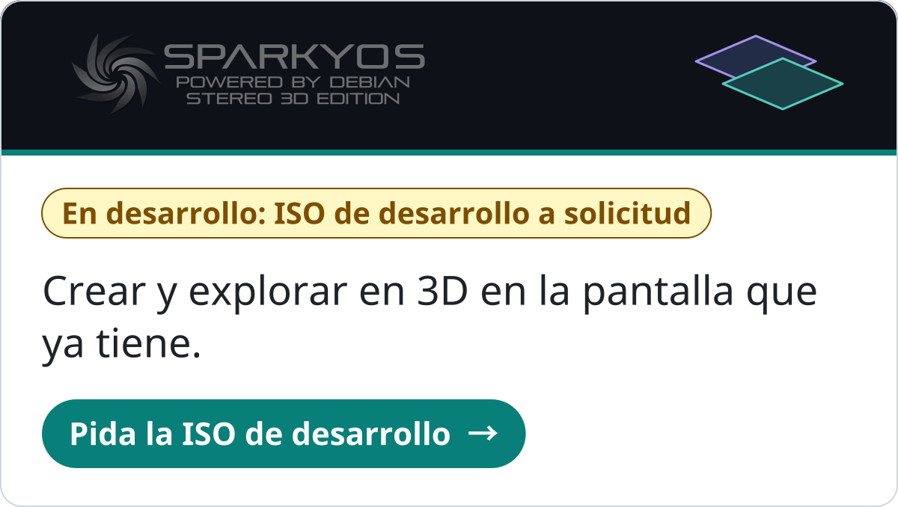

<picture>
  <source media="(prefers-color-scheme: dark)" srcset="./assets/banner-dark.svg">
  <source media="(prefers-color-scheme: light)" srcset="./assets/banner-light.svg">
  
</picture>

🇨🇦 [English](https://github.com/Sparky-OS) · 🇧🇷 [Português](https://github.com/Sparky-OS/.github/blob/main/profile/README.pt-BR.md) · 🇵🇱 [Polski](https://github.com/Sparky-OS/.github/blob/main/profile/README.pl.md) · 🇫🇷 [Français](https://github.com/Sparky-OS/.github/blob/main/profile/README.fr.md) · 🇩🇪 [Deutsch](https://github.com/Sparky-OS/.github/blob/main/profile/README.de.md) · 🇲🇽 [Español](https://github.com/Sparky-OS/.github/blob/main/profile/README.es.md) · 🇯🇵 [日本語](https://github.com/Sparky-OS/.github/blob/main/profile/README.ja.md) · 🇰🇷 [한국어](https://github.com/Sparky-OS/.github/blob/main/profile/README.ko.md) · 🇨🇳 [简体中文](https://github.com/Sparky-OS/.github/blob/main/profile/README.zh-CN.md) · 🇭🇰 [繁體中文](https://github.com/Sparky-OS/.github/blob/main/profile/README.zh-TW.md)

# Sparky-OS

**Tres sistemas Linux que se complementan: uno funciona desde una memoria USB que usted lleva consigo, otro muestra su escritorio, sus películas y sus juegos en 3D en la pantalla que ya tiene y el tercero es para pequeñas empresas.**
Hechos por Paweł "pavroo" Pijanowski, creador de SparkyLinux, y por Daniel Ramos.

## SparkyOS onUSB

<a href="https://sparkyos.sparkylinux.org/">
<picture>
  <source media="(prefers-color-scheme: dark)" srcset="./assets/cards/onusb-es-dark.svg">
  <source media="(prefers-color-scheme: light)" srcset="./assets/cards/onusb-es-light.svg">
  
</picture>
</a>

Todo el sistema funciona desde la memoria USB y se actualiza como un sistema instalado en un disco; no se instala nada en el equipo.
Tiene dos ediciones, una basada en Arch Linux y otra en Debian, ambas con el ligero escritorio Xfce, para PC de 64 bits.
De Paweł "pavroo" Pijanowski y el equipo de SparkyLinux (sitio en inglés): [su página principal](https://sparkyos.sparkylinux.org/) · [Descarga](https://sparkyos.sparkylinux.org/download/) · [Guías (How-To)](https://sparkyos.sparkylinux.org/how-to/)

## Sparky Stereo OS

<a href="https://github.com/Sparky-OS/sparky-stereo-os/issues/351">
<picture>
  <source media="(prefers-color-scheme: dark)" srcset="./assets/cards/stereo-es-dark.svg">
  <source media="(prefers-color-scheme: light)" srcset="./assets/cards/stereo-es-light.svg">
  
</picture>
</a>

Pintar, editar fotos y vídeo, estudiar moléculas y globos terráqueos, y después ver películas y jugar.
Está hecho para todo tipo de pantalla 3D: televisores y proyectores 3D, cascos de realidad virtual, pantallas 3D sin gafas y cualquier monitor con gafas rojo-cian.
En un monitor 2D común, el mismo escritorio funciona sin ningún cambio.

 

*Con gafas rojo-cian, estas imágenes se ven en 3D ([más](https://github.com/Sparky-OS/sparky-stereo-os/blob/main/docs/edition-in-detail.md#seen-in-3d)).*

Sparky Stereo OS, la edición de Daniel Ramos de SparkyLinux (de Paweł "pavroo" Pijanowski), es un sistema Linux con un nuevo escritorio Stereo KDE Plasma.
Probado en televisores 3D, en monitores comunes con gafas rojo-cian y en un teléfono Android en un visor económico; las pantallas sin gafas y los cascos autónomos están en desarrollo.

**La ISO de desarrollo es para desarrolladores y se envía a solicitud:** pídala y cuéntenos qué equipo 3D tiene, en su idioma: [🇨🇦](https://github.com/Sparky-OS/sparky-stereo-os/issues/26) [🇧🇷](https://github.com/Sparky-OS/sparky-stereo-os/issues/25) [🇵🇱](https://github.com/Sparky-OS/sparky-stereo-os/issues/27) [🇫🇷](https://github.com/Sparky-OS/sparky-stereo-os/issues/80) [🇩🇪](https://github.com/Sparky-OS/sparky-stereo-os/issues/153) [🇲🇽](https://github.com/Sparky-OS/sparky-stereo-os/issues/351) [🇯🇵](https://github.com/Sparky-OS/sparky-stereo-os/issues/81) [🇰🇷](https://github.com/Sparky-OS/sparky-stereo-os/issues/83) [🇨🇳](https://github.com/Sparky-OS/sparky-stereo-os/issues/84) [🇭🇰](https://github.com/Sparky-OS/sparky-stereo-os/issues/85)

**Más:** [la edición](https://github.com/Sparky-OS/sparky-stereo-os/blob/main/README.es.md) · [una guía para probarlo en Windows](https://github.com/Sparky-OS/sparky-stereo-os/blob/main/docs/guides/try-on-windows.es.md) · en inglés: [lo que está hecho, en detalle](https://github.com/Sparky-OS/.github/blob/main/profile/in-detail.md#sparky-stereo-os) · [cómo está construida](https://github.com/Sparky-OS/sparky-stereo-os/blob/main/docs/architectural-synthesis.md) · [nuestros forks](https://github.com/Sparky-OS/.github/blob/main/profile/in-detail.md#repositories)

## Sparky Business: servidor y cliente

<a href="https://github.com/Sparky-OS/.github/blob/main/profile/in-detail.md#business-editions">
<picture>
  <source media="(prefers-color-scheme: dark)" srcset="./assets/cards/business-es-dark.svg">
  <source media="(prefers-color-scheme: light)" srcset="./assets/cards/business-es-light.svg">
  
</picture>
</a>

Empezó en 2018 con una línea de servidor y estaciones de trabajo para pequeñas empresas.
Sus ediciones de servidor y cliente, de Daniel Ramos y Paweł Pijanowski, llegan después de la edición estéreo.
[En detalle](https://github.com/Sparky-OS/.github/blob/main/profile/in-detail.md#business-editions) (en inglés): qué es y sus repositorios.

## Personas

| | |
| --- | --- |
|  | **Daniel Ramos (Capitain Jack)** Ingeniero electricista, construye la edición estéreo y, con Paweł, las ediciones empresariales.   |
|  | **Paweł "pavroo" Pijanowski** Creador de SparkyLinux y de SparkyOS onUSB; las ediciones estéreo y empresariales se basan en las herramientas y las versiones de SparkyLinux.   |

**Mantenedores de paquetes**, cada uno con plenos derechos sobre su propio repositorio aquí:

| | |
| --- | --- |
|  | **Eff (effcol)** Mantiene [wiz3D](https://github.com/effcol/wiz3D), el envoltorio estereoscópico 3D universal para DirectX, OpenGL, AMD HD3D y NVIDIA 3D Vision, basado en iZ3D, para todos los sistemas, y su paquete aquí, [Sparky-OS/wiz3D](https://github.com/Sparky-OS/wiz3D).  |
|  | **Jeromy Streets (halverneus)** Creó y mantiene [org.kde.video](https://github.com/Sparky-OS/org.kde.video), el fondo de pantalla de vídeo y la pantalla de bloqueo para KDE Plasma.  |
|  | **Pedro F. Albanese (pedroalbanese)** Mantiene [Sparky CA](https://github.com/Sparky-OS/sparky-ca) con Daniel, la herramienta que instala los certificados brasileños ICP-Brasil y los mantiene al día, y escribió [e521](https://github.com/pedroalbanese/e521), la biblioteca de las firmas Ed521 que usa una raíz ICP-Brasil.  |

## Repositorios

[sparky-stereo-os](https://github.com/Sparky-OS/sparky-stereo-os) reúne los documentos, las habilidades (skills) y las herramientas de la edición.
Cada fork por área, los repositorios de las ediciones empresariales, las herramientas y el arte: [en detalle](https://github.com/Sparky-OS/.github/blob/main/profile/in-detail.md#repositories) (en inglés).
Las listas abiertas de Daniel y los forks relacionados: [trabajo relacionado](https://github.com/Sparky-OS/.github/blob/main/profile/in-detail.md#related-work) (en inglés).

## Cómo se relaciona esto con SparkyLinux

SparkyLinux es la distribución de Paweł Pijanowski, y las ediciones estéreo y empresariales se basan en ella.
Sparky Stereo OS es una edición de SparkyLinux, no un sustituto.
Las herramientas, los repositorios y los nombres de versión de Sparky siguen siendo de Paweł, y nuestros paquetes dependen de ellos en lugar de copiarlos.
[En detalle](https://github.com/Sparky-OS/.github/blob/main/profile/in-detail.md#how-this-relates-to-sparkylinux) (en inglés)

[SparkyLinux](https://sparkylinux.org) · [Donar a SparkyLinux](https://sparkylinux.org/donate/) · [github.com/sparkylinux](https://github.com/sparkylinux) · [Daniel en GitHub](https://github.com/danielcamposramos) · [Patrocinar a Daniel](https://github.com/sponsors/danielcamposramos)
