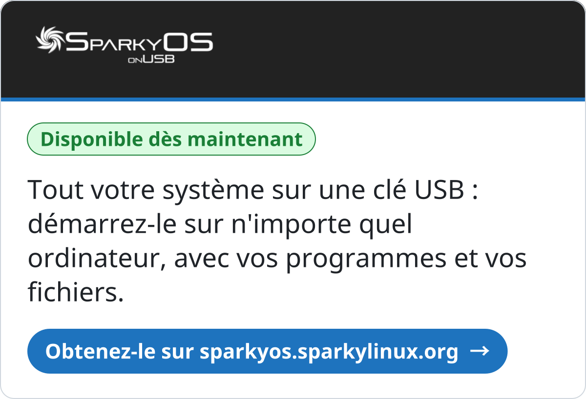
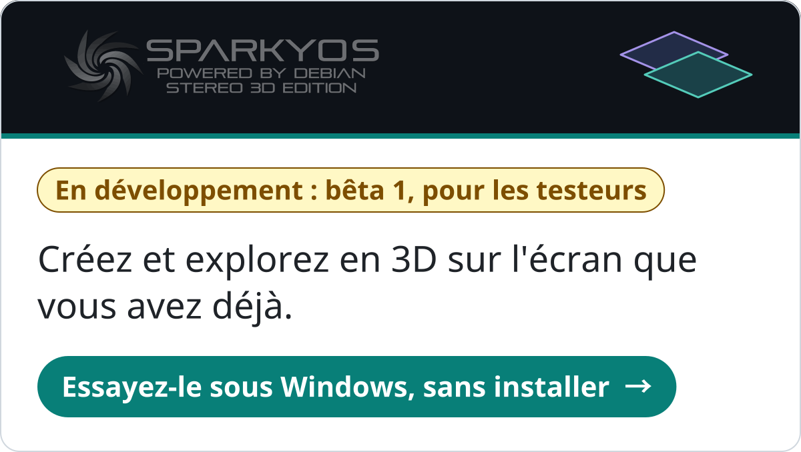

<picture>
  <source media="(prefers-color-scheme: dark)" srcset="./assets/banner-dark.svg">
  <source media="(prefers-color-scheme: light)" srcset="./assets/banner-light.svg">
  
</picture>

🇨🇦 [English](https://github.com/Sparky-OS) · 🇧🇷 [Português](https://github.com/Sparky-OS/.github/blob/main/profile/README.pt-BR.md) · 🇵🇱 [Polski](https://github.com/Sparky-OS/.github/blob/main/profile/README.pl.md) · 🇫🇷 [Français](https://github.com/Sparky-OS/.github/blob/main/profile/README.fr.md) · 🇩🇪 [Deutsch](https://github.com/Sparky-OS/.github/blob/main/profile/README.de.md) · 🇲🇽 [Español](https://github.com/Sparky-OS/.github/blob/main/profile/README.es.md) · 🇯🇵 [日本語](https://github.com/Sparky-OS/.github/blob/main/profile/README.ja.md) · 🇰🇷 [한국어](https://github.com/Sparky-OS/.github/blob/main/profile/README.ko.md) · 🇨🇳 [简体中文](https://github.com/Sparky-OS/.github/blob/main/profile/README.zh-CN.md) · 🇭🇰 [繁體中文](https://github.com/Sparky-OS/.github/blob/main/profile/README.zh-TW.md)

# Sparky-OS

**Trois systèmes Linux qui se complètent : l'un fonctionne depuis une clé USB que vous emportez, l'autre affiche votre bureau, vos films et vos jeux en 3D sur l'écran que vous avez déjà, et le troisième est fait pour les petites entreprises.**
Créés par Paweł « pavroo » Pijanowski, le créateur de SparkyLinux, et par Daniel Ramos.

## SparkyOS onUSB

<a href="https://sparkyos.sparkylinux.org/">
<picture>
  <source media="(prefers-color-scheme: dark)" srcset="./assets/cards/onusb-fr-dark.svg">
  <source media="(prefers-color-scheme: light)" srcset="./assets/cards/onusb-fr-light.svg">
  
</picture>
</a>

Tout le système fonctionne depuis la clé USB et se met à jour comme un système installé sur un disque ; rien n'est installé sur l'ordinateur.
Il existe en deux éditions, l'une basée sur Arch Linux, l'autre sur Debian, toutes deux avec le bureau léger Xfce, pour les PC 64 bits.
Par Paweł « pavroo » Pijanowski et l'équipe de SparkyLinux (site en anglais) : [sa page d'accueil](https://sparkyos.sparkylinux.org/) · [Téléchargement](https://sparkyos.sparkylinux.org/download/) · [Guides (How-To)](https://sparkyos.sparkylinux.org/how-to/)

## Sparky Stereo OS

<a href="https://github.com/Sparky-OS/sparky-stereo-os/blob/main/docs/guides/try-on-windows.en.md">
<picture>
  <source media="(prefers-color-scheme: dark)" srcset="./assets/cards/stereo-fr-dark.svg">
  <source media="(prefers-color-scheme: light)" srcset="./assets/cards/stereo-fr-light.svg">
  
</picture>
</a>

Peinture, retouche de photos et de vidéos, étude de molécules et de globes, puis films et jeux.
Il est conçu pour tous les types d'écrans 3D : téléviseurs et projecteurs 3D, casques VR, écrans 3D sans lunettes et n'importe quel écran avec des lunettes rouge-cyan.
Sur un écran 2D ordinaire, le même bureau fonctionne sans aucun changement.

 

*Des lunettes rouge-cyan les montrent en 3D ([plus](https://github.com/Sparky-OS/sparky-stereo-os/blob/main/docs/edition-in-detail.fr.md#seen-in-3d)).*

Sparky Stereo OS, l'édition de Daniel Ramos de SparkyLinux (par Paweł « pavroo » Pijanowski), est un système Linux doté d'un nouveau bureau KDE Plasma stéréo.
Testé sur des téléviseurs 3D, sur des écrans ordinaires avec des lunettes rouge-cyan et sur un téléphone Android dans une visionneuse peu coûteuse ; les écrans sans lunettes et les casques autonomes sont en cours.

**Étape suivante : essayez-le sur votre PC Windows, depuis une clé USB, sans rien installer :** [une page, dix étapes (en anglais)](https://github.com/Sparky-OS/sparky-stereo-os/blob/main/docs/guides/try-on-windows.en.md).
 Demandez le téléchargement et parlez-nous de votre matériel 3D, dans votre langue : [🇨🇦](https://github.com/Sparky-OS/sparky-stereo-os/issues/26) [🇧🇷](https://github.com/Sparky-OS/sparky-stereo-os/issues/25) [🇵🇱](https://github.com/Sparky-OS/sparky-stereo-os/issues/27) [🇫🇷](https://github.com/Sparky-OS/sparky-stereo-os/issues/80) [🇩🇪](https://github.com/Sparky-OS/sparky-stereo-os/issues/153) [🇲🇽](https://github.com/Sparky-OS/sparky-stereo-os/issues/351) [🇯🇵](https://github.com/Sparky-OS/sparky-stereo-os/issues/81) [🇰🇷](https://github.com/Sparky-OS/sparky-stereo-os/issues/83) [🇨🇳](https://github.com/Sparky-OS/sparky-stereo-os/issues/84) [🇭🇰](https://github.com/Sparky-OS/sparky-stereo-os/issues/85)

**Plus :** [l'édition](https://github.com/Sparky-OS/sparky-stereo-os/blob/main/README.fr.md) · en anglais : [ce qui est construit, en détail](https://github.com/Sparky-OS/.github/blob/main/profile/in-detail.md#sparky-stereo-os) · [comment elle est construite](https://github.com/Sparky-OS/sparky-stereo-os/blob/main/docs/architectural-synthesis.md) · [nos forks](https://github.com/Sparky-OS/.github/blob/main/profile/in-detail.md#repositories)

## Sparky Business : serveur et client

<a href="https://github.com/Sparky-OS/.github/blob/main/profile/in-detail.md#business-editions">
<picture>
  <source media="(prefers-color-scheme: dark)" srcset="./assets/cards/business-fr-dark.svg">
  <source media="(prefers-color-scheme: light)" srcset="./assets/cards/business-fr-light.svg">
  
</picture>
</a>

Tout a commencé en 2018 avec une gamme de serveur et de postes de travail pour petites entreprises.
Ses éditions serveur et client, par Daniel Ramos et Paweł Pijanowski, arrivent après l'édition stéréo.
[En détail](https://github.com/Sparky-OS/.github/blob/main/profile/in-detail.md#business-editions) (en anglais) : ce que c'est et ses dépôts.

## Personnes

| | |
| --- | --- |
|  | **Daniel Ramos (Capitain Jack)** Ingénieur électricien, construit l'édition stéréo et, avec Paweł, les éditions professionnelles.   |
|  | **Paweł "pavroo" Pijanowski** Créateur de SparkyLinux et de SparkyOS onUSB ; les éditions stéréo et professionnelles s'appuient sur les outils et les versions de SparkyLinux.   |

**Mainteneurs de paquets**, chacun avec tous les droits sur son propre dépôt ici :

| | |
| --- | --- |
|  | **Eff (effcol)** Maintient [wiz3D](https://github.com/effcol/wiz3D), l'enveloppe stéréoscopique 3D universelle pour DirectX, OpenGL, AMD HD3D et NVIDIA 3D Vision, basée sur iZ3D, pour tous les systèmes, et son paquet ici, [Sparky-OS/wiz3D](https://github.com/Sparky-OS/wiz3D).  |
|  | **Jeromy Streets (halverneus)** A créé et maintient [org.kde.video](https://github.com/Sparky-OS/org.kde.video), le fond d'écran vidéo et l'écran de verrouillage pour KDE Plasma.  |
|  | **Pedro F. Albanese (pedroalbanese)** Maintient [Sparky CA](https://github.com/Sparky-OS/sparky-ca) avec Daniel, l'outil qui installe les certificats brésiliens ICP-Brasil et les tient à jour, et a écrit [e521](https://github.com/pedroalbanese/e521), la bibliothèque des signatures Ed521 qu'utilise une racine ICP-Brasil.  |

## Dépôts

[sparky-stereo-os](https://github.com/Sparky-OS/sparky-stereo-os) contient les documents, les compétences (skills) et les outils de l'édition.
Chaque fork par domaine, les dépôts des éditions professionnelles, les outils et les illustrations : [en détail](https://github.com/Sparky-OS/.github/blob/main/profile/in-detail.md#repositories) (en anglais).
Les listes ouvertes de Daniel et les forks associés : [travaux liés](https://github.com/Sparky-OS/.github/blob/main/profile/in-detail.md#related-work) (en anglais).

## Le lien avec SparkyLinux

SparkyLinux est la distribution de Paweł Pijanowski, et les éditions stéréo et professionnelles reposent sur elle.
Sparky Stereo OS est une édition de SparkyLinux, pas un remplaçant.
Les outils, les dépôts et les noms de version de Sparky restent ceux de Paweł, et nos paquets en dépendent au lieu de les copier.
[En détail](https://github.com/Sparky-OS/.github/blob/main/profile/in-detail.md#how-this-relates-to-sparkylinux) (en anglais)

[SparkyLinux](https://sparkylinux.org) · [Faire un don à SparkyLinux](https://sparkylinux.org/donate/) · [github.com/sparkylinux](https://github.com/sparkylinux) · [Daniel sur GitHub](https://github.com/danielcamposramos) · [Soutenir Daniel](https://github.com/sponsors/danielcamposramos)
