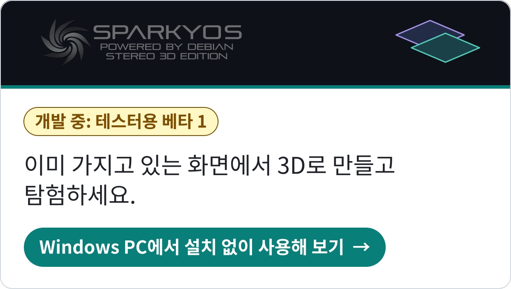

<picture>
  <source media="(prefers-color-scheme: dark)" srcset="./assets/banner-dark.svg">
  <source media="(prefers-color-scheme: light)" srcset="./assets/banner-light.svg">
  
</picture>

🇨🇦 [English](https://github.com/Sparky-OS) · 🇧🇷 [Português](https://github.com/Sparky-OS/.github/blob/main/profile/README.pt-BR.md) · 🇵🇱 [Polski](https://github.com/Sparky-OS/.github/blob/main/profile/README.pl.md) · 🇫🇷 [Français](https://github.com/Sparky-OS/.github/blob/main/profile/README.fr.md) · 🇩🇪 [Deutsch](https://github.com/Sparky-OS/.github/blob/main/profile/README.de.md) · 🇲🇽 [Español](https://github.com/Sparky-OS/.github/blob/main/profile/README.es.md) · 🇯🇵 [日本語](https://github.com/Sparky-OS/.github/blob/main/profile/README.ja.md) · 🇰🇷 [한국어](https://github.com/Sparky-OS/.github/blob/main/profile/README.ko.md) · 🇨🇳 [简体中文](https://github.com/Sparky-OS/.github/blob/main/profile/README.zh-CN.md) · 🇭🇰 [繁體中文](https://github.com/Sparky-OS/.github/blob/main/profile/README.zh-TW.md)

# Sparky-OS

**서로를 보완하는 세 가지 Linux 시스템: 가지고 다니는 USB 드라이브에서 실행되는 시스템, 데스크톱과 영화와 게임을 이미 가진 화면에서 3D로 보여 주는 시스템, 그리고 소규모 사업장을 위한 시스템입니다.**
SparkyLinux를 만든 Paweł "pavroo" Pijanowski와 Daniel Ramos가 만듭니다.

## SparkyOS onUSB

<a href="https://sparkyos.sparkylinux.org/">
<picture>
  <source media="(prefers-color-scheme: dark)" srcset="./assets/cards/onusb-ko-dark.svg">
  <source media="(prefers-color-scheme: light)" srcset="./assets/cards/onusb-ko-light.svg">
  
</picture>
</a>

시스템 전체가 USB 드라이브에서 실행되고 디스크에 설치된 시스템처럼 업데이트됩니다. 컴퓨터에는 아무것도 설치하지 않습니다.
Arch Linux 기반과 Debian 기반의 두 가지 에디션이 있으며, 둘 다 가벼운 Xfce 데스크톱을 쓰고 64비트 PC용입니다.
만든 사람: Paweł "pavroo" Pijanowski와 SparkyLinux 팀(사이트는 영어): [홈페이지](https://sparkyos.sparkylinux.org/) · [다운로드](https://sparkyos.sparkylinux.org/download/) · [사용 방법(How-To)](https://sparkyos.sparkylinux.org/how-to/)

## Sparky Stereo OS

<a href="https://github.com/Sparky-OS/sparky-stereo-os/issues/83">
<picture>
  <source media="(prefers-color-scheme: dark)" srcset="./assets/cards/stereo-ko-dark.svg">
  <source media="(prefers-color-scheme: light)" srcset="./assets/cards/stereo-ko-light.svg">
  
</picture>
</a>

그림을 그리고, 사진과 비디오를 편집하고, 분자와 지구본을 연구한 다음, 영화를 보고 게임을 즐기세요.
3D TV와 3D 프로젝터, VR 헤드셋, 무안경 3D 디스플레이, 적청 안경을 쓴 모든 모니터 등 모든 종류의 3D 화면을 위해 만들어졌습니다.
일반 2D 모니터에서는 같은 데스크톱이 아무 변경 없이 그대로 작동합니다.

 

*적청 안경으로 이들을 3D로 볼 수 있습니다 ([더 보기](https://github.com/Sparky-OS/sparky-stereo-os/blob/main/docs/edition-in-detail.ko.md#seen-in-3d)).*

Sparky Stereo OS는 Daniel Ramos의 SparkyLinux 에디션(Paweł "pavroo" Pijanowski 제작)으로, 새로운 Stereo KDE Plasma 데스크톱을 갖춘 Linux 시스템입니다.
3D TV, 적청 안경을 쓴 일반 모니터, 저렴한 뷰어에 넣은 Android 휴대폰에서 테스트했습니다. 무안경 디스플레이와 독립형 헤드셋은 진행 중입니다.

**개발자용 ISO는 개발자를 위한 것이며 요청하시면 보내 드립니다:** 원하는 언어로 요청하고 여러분의 3D 장비를 알려 주세요: [🇨🇦](https://github.com/Sparky-OS/sparky-stereo-os/issues/26) [🇧🇷](https://github.com/Sparky-OS/sparky-stereo-os/issues/25) [🇵🇱](https://github.com/Sparky-OS/sparky-stereo-os/issues/27) [🇫🇷](https://github.com/Sparky-OS/sparky-stereo-os/issues/80) [🇩🇪](https://github.com/Sparky-OS/sparky-stereo-os/issues/153) [🇲🇽](https://github.com/Sparky-OS/sparky-stereo-os/issues/351) [🇯🇵](https://github.com/Sparky-OS/sparky-stereo-os/issues/81) [🇰🇷](https://github.com/Sparky-OS/sparky-stereo-os/issues/83) [🇨🇳](https://github.com/Sparky-OS/sparky-stereo-os/issues/84) [🇭🇰](https://github.com/Sparky-OS/sparky-stereo-os/issues/85)

**더 보기:** [에디션](https://github.com/Sparky-OS/sparky-stereo-os/blob/main/README.ko.md) · [Windows에서 사용해 보는 안내서](https://github.com/Sparky-OS/sparky-stereo-os/blob/main/docs/guides/try-on-windows.en.md) (영어) · 영어: [만들어진 것 자세히](https://github.com/Sparky-OS/.github/blob/main/profile/in-detail.md#sparky-stereo-os) · [만드는 방식](https://github.com/Sparky-OS/sparky-stereo-os/blob/main/docs/architectural-synthesis.md) · [포크 목록](https://github.com/Sparky-OS/.github/blob/main/profile/in-detail.md#repositories)

## Sparky Business: 서버와 클라이언트

<a href="https://github.com/Sparky-OS/.github/blob/main/profile/in-detail.md#business-editions">
<picture>
  <source media="(prefers-color-scheme: dark)" srcset="./assets/cards/business-ko-dark.svg">
  <source media="(prefers-color-scheme: light)" srcset="./assets/cards/business-ko-light.svg">
  
</picture>
</a>

2018년에 소규모 사업장용 서버와 워크스테이션 라인으로 시작했습니다.
Daniel Ramos와 Paweł Pijanowski의 서버 에디션과 클라이언트 에디션은 Sparky Stereo OS 다음에 나옵니다.
[자세히](https://github.com/Sparky-OS/.github/blob/main/profile/in-detail.md#business-editions) (영어): 무엇인지와 저장소.

## 사람들

| | |
| --- | --- |
|  | **Daniel Ramos (Capitain Jack)** 전기 엔지니어. 스테레오 에디션을 만들고, Paweł와 함께 비즈니스 에디션을 만듭니다.   |
|  | **Paweł "pavroo" Pijanowski** SparkyLinux와 SparkyOS onUSB를 만든 사람. 스테레오 에디션과 비즈니스 에디션은 SparkyLinux의 도구와 릴리스를 바탕으로 합니다.   |

**패키지 관리자**, 각자 여기 있는 자신의 저장소에 대한 모든 권한을 가지고 있습니다:

| | |
| --- | --- |
|  | **Eff (effcol)** [wiz3D](https://github.com/effcol/wiz3D)를 관리합니다. iZ3D를 바탕으로 한 DirectX, OpenGL, AMD HD3D, NVIDIA 3D Vision용 범용 입체 3D 래퍼로 모든 시스템에서 쓸 수 있으며, 여기 있는 패키지 [Sparky-OS/wiz3D](https://github.com/Sparky-OS/wiz3D)도 관리합니다.  |
|  | **Jeromy Streets (halverneus)** KDE Plasma용 비디오 배경화면과 잠금 화면인 [org.kde.video](https://github.com/Sparky-OS/org.kde.video)를 만들고 관리합니다.  |
|  | **Pedro F. Albanese (pedroalbanese)** Daniel과 함께 브라질의 ICP-Brasil 인증서를 설치하고 최신으로 유지하는 도구 [Sparky CA](https://github.com/Sparky-OS/sparky-ca)를 관리하며, ICP-Brasil 루트 하나가 쓰는 Ed521 서명용 라이브러리 [e521](https://github.com/pedroalbanese/e521)을 작성했습니다.  |

## 저장소

[sparky-stereo-os](https://github.com/Sparky-OS/sparky-stereo-os)에는 에디션의 문서, 스킬, 도구가 있습니다.
분야별 모든 포크, 비즈니스 에디션의 저장소, 도구와 아트워크: [자세히](https://github.com/Sparky-OS/.github/blob/main/profile/in-detail.md#repositories) (영어).
Daniel의 공개 목록과 관련 포크: [관련 작업](https://github.com/Sparky-OS/.github/blob/main/profile/in-detail.md#related-work) (영어).

## SparkyLinux와의 관계

SparkyLinux는 Paweł Pijanowski의 배포판이며, 스테레오 에디션과 비즈니스 에디션은 이를 바탕으로 합니다.
Sparky Stereo OS는 SparkyLinux의 에디션이지, 그것을 대신하는 것이 아닙니다.
Sparky 고유의 도구, 저장소, 릴리스 이름은 Paweł의 것으로 남으며, 우리 패키지는 그것들을 복사하지 않고 의존합니다.
[자세히](https://github.com/Sparky-OS/.github/blob/main/profile/in-detail.md#how-this-relates-to-sparkylinux) (영어)

[SparkyLinux](https://sparkylinux.org) · [SparkyLinux에 기부](https://sparkylinux.org/donate/) · [github.com/sparkylinux](https://github.com/sparkylinux) · [GitHub의 Daniel](https://github.com/danielcamposramos) · [Daniel 후원하기](https://github.com/sponsors/danielcamposramos)
