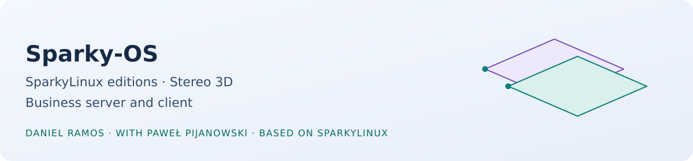

<picture>
  <source media="(prefers-color-scheme: dark)" srcset="./assets/banner-dark.svg">
  <source media="(prefers-color-scheme: light)" srcset="./assets/banner-light.svg">
  
</picture>

# Sparky-OS

**Create and explore in 3D on the screen you already have: paint, edit photos and video, study molecules and globes, then watch films and play games.**
It is made for every kind of 3D screen: 3D TVs and projectors, VR headsets, glasses-free 3D displays, and any monitor with red-cyan glasses.
On a plain 2D monitor the same desktop works without any change.
This is where it is built: Sparky Stereo OS, Daniel Ramos's edition of SparkyLinux (by Paweł "pavroo" Pijanowski), a Linux system with the KDE Plasma desktop.

**Lighter on your machine and on the planet:** every package ships without the comments and notes that programs never read, so the same work takes less processing, less energy and less wear.
[Measured](https://github.com/Sparky-OS/sparky-stereo-os/blob/main/docs/lean-code-packages.md#why-it-matters): reading the C++ headers takes 2 to 4% less work than on Debian, with nothing lost.

 

*Red-cyan glasses show these in 3D.*

**Status: beta 1, for testers.** Tested on 3D TVs, on ordinary monitors with red-cyan glasses and on an Android phone in an inexpensive viewer; glasses-free displays and standalone headsets are in progress.

- **[Sparky Stereo OS](https://github.com/Sparky-OS/sparky-stereo-os):** what it does for watching, playing, creating and developing, and how it is built.
- **[Illustrated architecture and repository guide](https://github.com/Sparky-OS/sparky-stereo-os/blob/main/docs/architectural-synthesis.md):** the display pipeline, desktop depth, media and system components, with sources, implementation status and an [infographic with a text version](https://github.com/Sparky-OS/sparky-stereo-os/blob/main/docs/architecture-infographic.md); adapted from Daniel's Gemini / NotebookLM research.
- **[Our forks](https://github.com/Sparky-OS/.github/blob/main/profile/in-detail.md#repositories):** the programs we change for 3D, from KDE and the Linux kernel to video players and science programs.
- **[Business editions](https://github.com/Sparky-OS/.github/blob/main/profile/in-detail.md#business-editions):** a small-business server and its workstations, after the stereo edition.

**Next step: try it on your Windows PC from a USB stick, without installing anything:** [one page, ten steps](https://github.com/Sparky-OS/sparky-stereo-os/blob/main/docs/guides/try-on-windows.en.md).
Ask for the download and tell us about your 3D gear, in your language: [🇨🇦](https://github.com/Sparky-OS/sparky-stereo-os/issues/26) [🇧🇷](https://github.com/Sparky-OS/sparky-stereo-os/issues/25) [🇵🇱](https://github.com/Sparky-OS/sparky-stereo-os/issues/27) [🇫🇷](https://github.com/Sparky-OS/sparky-stereo-os/issues/80) [🇩🇪](https://github.com/Sparky-OS/sparky-stereo-os/issues/153) [🇯🇵](https://github.com/Sparky-OS/sparky-stereo-os/issues/81) [🇰🇷](https://github.com/Sparky-OS/sparky-stereo-os/issues/83) [🇨🇳](https://github.com/Sparky-OS/sparky-stereo-os/issues/84) [🇭🇰](https://github.com/Sparky-OS/sparky-stereo-os/issues/85)

## People

| | |
| --- | --- |
|  | **Daniel Ramos (Capitain Jack)** Electrical engineer, builds the stereo edition and the business editions.   |
|  | **Paweł "pavroo" Pijanowski** Creator of SparkyLinux, whose tools and releases everything here builds on.   |

**Package maintainers**, each with full rights over their own repository here:

| | |
| --- | --- |
|  | **Eff (effcol)** Maintains [wiz3D](https://github.com/effcol/wiz3D), the universal stereoscopic 3D wrapper for DirectX, OpenGL, AMD HD3D and NVIDIA 3D Vision, based on iZ3D, for every system, and its package here, [Sparky-OS/wiz3D](https://github.com/Sparky-OS/wiz3D).  |
|  | **Jeromy Streets (halverneus)** Created and maintains [org.kde.video](https://github.com/Sparky-OS/org.kde.video), the video wallpaper and lock screen for KDE Plasma.  |

## Sparky Stereo OS

**Sparky Stereo OS 9 "Mashtabba", based on Debian 14 "Forky".**
It is Daniel Ramos's edition of SparkyLinux (by Paweł "pavroo" Pijanowski), with stereo 3D built in from the kernel to the desktop.
What is built, what is coming and what was merged upstream: [in detail](https://github.com/Sparky-OS/.github/blob/main/profile/in-detail.md#sparky-stereo-os).

## Business editions

It started in 2018 with a small-business server and workstation line.
Server and client editions come after the stereo edition.
[In detail](https://github.com/Sparky-OS/.github/blob/main/profile/in-detail.md#business-editions)

## Repositories

[sparky-stereo-os](https://github.com/Sparky-OS/sparky-stereo-os) holds the edition's documents, skills and tools.
Every fork by area, the business editions' repositories, the tools and the artwork: [in detail](https://github.com/Sparky-OS/.github/blob/main/profile/in-detail.md#repositories).
Daniel's open lists and related forks: [related work](https://github.com/Sparky-OS/.github/blob/main/profile/in-detail.md#related-work).

## How this relates to SparkyLinux

SparkyLinux is Paweł Pijanowski's distribution, and everything here builds on it.
Sparky Stereo OS is an edition of SparkyLinux, not a replacement for it.
Sparky's own tools, repositories and release names stay Paweł's, and our packages depend on them rather than copy them.
[In detail](https://github.com/Sparky-OS/.github/blob/main/profile/in-detail.md#how-this-relates-to-sparkylinux)

[SparkyLinux](https://sparkylinux.org) · [Donate to SparkyLinux](https://sparkylinux.org/donate/) · [github.com/sparkylinux](https://github.com/sparkylinux) · [Daniel on GitHub](https://github.com/danielcamposramos) · [Sponsor Daniel](https://github.com/sponsors/danielcamposramos)
