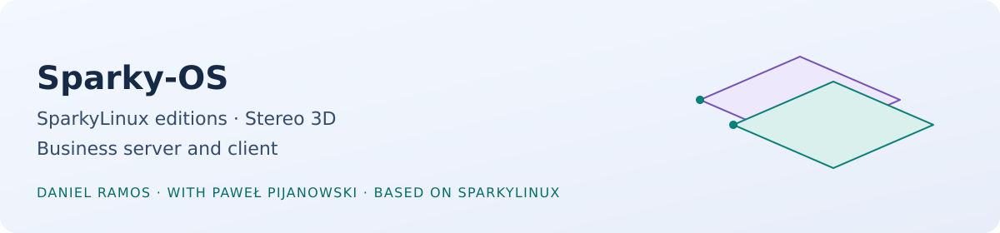

<picture>
  <source media="(prefers-color-scheme: dark)" srcset="./assets/banner-dark.svg">
  <source media="(prefers-color-scheme: light)" srcset="./assets/banner-light.svg">
  
</picture>

# Sparky-OS

**Create and explore in 3D on the screen you already have: paint, edit photos and video, study molecules and globes, then watch films and play games.**
A 3D TV works, and so does any ordinary monitor with cheap red-cyan glasses.
This is where it is built: Sparky Stereo OS, Daniel Ramos's edition of SparkyLinux (by Paweł "pavroo" Pijanowski), a Linux system with the KDE Plasma desktop.

 

*Red-cyan glasses show these in 3D.*

**In development:** the [Flat Headset development APK and matching PC update instructions](https://github.com/Sparky-OS/flat-headset/tree/main/apk) are available; the final stereo edition ISO is still being prepared.

- **[Sparky Stereo OS](https://github.com/Sparky-OS/sparky-stereo-os):** what it does for watching, playing, creating and developing, and how it is built.
- **[Architecture and repository guide](https://github.com/Sparky-OS/sparky-stereo-os/blob/main/docs/architectural-synthesis.md):** the display pipeline, desktop depth, media and system components, with sources and implementation status; adapted from Daniel's Gemini / NotebookLM research.
- **[Our forks](#repositories):** the programs we change for 3D, from KDE and the Linux kernel to video players and science programs.
- **[Business editions](#business-editions):** a small-business server and its workstations, after the stereo edition.

**Next step: tell us about your 3D gear** and hear first when it is ready.
Sign up in your language: [🇨🇦](https://github.com/Sparky-OS/sparky-stereo-os/issues/26) [🇧🇷](https://github.com/Sparky-OS/sparky-stereo-os/issues/25) [🇵🇱](https://github.com/Sparky-OS/sparky-stereo-os/issues/27) [🇫🇷](https://github.com/Sparky-OS/sparky-stereo-os/issues/80) [🇯🇵](https://github.com/Sparky-OS/sparky-stereo-os/issues/81) [🇰🇷](https://github.com/Sparky-OS/sparky-stereo-os/issues/83) [🇨🇳](https://github.com/Sparky-OS/sparky-stereo-os/issues/84) [🇭🇰](https://github.com/Sparky-OS/sparky-stereo-os/issues/85)

## People

| | |
| --- | --- |
|  | **Daniel Ramos (Capitain Jack)** Electrical engineer, builds the stereo edition and the business editions.  |
|  | **Paweł "pavroo" Pijanowski** Creator of SparkyLinux, whose tools and releases everything here builds on.  |

## Sparky Stereo OS

**Sparky Stereo OS 9 "Mashtabba", based on Debian 14 "Forky".**
It is Daniel Ramos's edition of SparkyLinux (by Paweł "pavroo" Pijanowski), with stereo 3D built in from the kernel to the desktop.
Mashtabba is "the Twins", the Babylonian name of the star pair that Greeks later called Castor and Pollux.
Paweł names each Sparky generation after a sky object that is also a myth, and a twin pair fits a stereo picture.

**What is built:**
- **3D modes in the display settings:** a 3D TV's own modes are listed and labelled beside the others, and the desktop shows in both eyes.
- **3D in a window or full screen:** a program or a game hands the desktop both eyes, and each eye gets its own picture, while the rest of the desktop stays flat.
- **Players and games:** 3D video in Haruna, VLC, mpv and more, and Half-Life 2 with its menus in both eyes.
- **Photos and pictures:** 3D photos in Gwenview, digiKam and KolourPaint, and one shared stereo layer for every picture viewer.
- **Drivers:** the NVIDIA open kernel modules with our patches.
- **Brazilian certificates:** sparky-ca for ICP-Brasil roots, tokens and smart cards.

**Coming:** the APTus Stereo AppCenter's stereo section on top of Paweł's APTus AppCenter, AMD's closed driver as a choice, stereo wallpapers and stereo screensavers.
**Merged upstream:** Universal Media Server keeps 3D video declared through transcoding, so televisions switch to 3D on their own; HandBrake, MKVToolNix and mpv took our 3D fixes too ([the list](https://github.com/Sparky-OS/sparky-stereo-os#merged-outside-sparky-stereo)).

**Status: in development.**
The first ISO is not published yet.
The packages, the patched kernel and the ISO are built in a development VM, and nothing here is a release.

## Business editions

It started in 2018 with a small-business server and workstation line.
Server and client editions come after the stereo edition.
Their first target is Brazil's justice system, lawyers and the financial world, with PJeOffice and certificates as must-haves.
The server side is a Samba 4 Active Directory domain controller installer with backup, time sync and service supervision.
The client side joins a workstation to that domain.
The code in the repositories below is from the Debian 9 and 10 era.
It will be ported to Debian 14 after the stereo edition.

## Repositories

**Stereo edition**

[sparky-stereo-os](https://github.com/Sparky-OS/sparky-stereo-os) holds the edition's documents, skills and tools.
Most forks below are the stereo version of one program, forked from its upstream project, with our changes on a stereo branch.

| Area | Forks |
| --- | --- |
| Desktop and display | [kwin](https://github.com/Sparky-OS/kwin), [kscreen](https://github.com/Sparky-OS/kscreen), [libkscreen](https://github.com/Sparky-OS/libkscreen), [plasma-wayland-protocols](https://github.com/Sparky-OS/plasma-wayland-protocols), [spectacle](https://github.com/Sparky-OS/spectacle), [kimageformats](https://github.com/Sparky-OS/kimageformats), [org.kde.video](https://github.com/Sparky-OS/org.kde.video), [qtbase](https://github.com/Sparky-OS/qtbase), [egl-wayland](https://github.com/Sparky-OS/egl-wayland), [linux](https://github.com/Sparky-OS/linux), [qemu](https://github.com/Sparky-OS/qemu) |
| Video and sound | [mpv](https://github.com/Sparky-OS/mpv), [vlc](https://github.com/Sparky-OS/vlc), [bino](https://github.com/Sparky-OS/bino), [mlt](https://github.com/Sparky-OS/mlt), [qtmultimedia](https://github.com/Sparky-OS/qtmultimedia), [pipewire](https://github.com/Sparky-OS/pipewire), [wireplumber](https://github.com/Sparky-OS/wireplumber), [plasma-pa](https://github.com/Sparky-OS/plasma-pa), [pulseaudio-qt](https://github.com/Sparky-OS/pulseaudio-qt) |
| Science, CAD and 3D viewers | [openscad](https://github.com/Sparky-OS/openscad), [grass](https://github.com/Sparky-OS/grass), [octave](https://github.com/Sparky-OS/octave), [netgen](https://github.com/Sparky-OS/netgen), [f3d](https://github.com/Sparky-OS/f3d), [avogadrolibs](https://github.com/Sparky-OS/avogadrolibs) |
| Games and Windows programs | [proton-wine](https://github.com/Sparky-OS/proton-wine), [wine](https://github.com/Sparky-OS/wine), [dxvk](https://github.com/Sparky-OS/dxvk), [glfw](https://github.com/Sparky-OS/glfw), [source-sdk-2013](https://github.com/Sparky-OS/source-sdk-2013), [KHARVOX](https://github.com/Sparky-OS/KHARVOX) |
| Web | [waterfox-stereo](https://github.com/Sparky-OS/waterfox-stereo) |
| Phones as 3D screens (planned) | [flat-headset](https://github.com/Sparky-OS/flat-headset), [stereodroid](https://github.com/Sparky-OS/stereodroid) |
| App center | [sparky-aptus-stereo-appcenter](https://github.com/Sparky-OS/sparky-aptus-stereo-appcenter): a fork of Paweł's APTus AppCenter that adds the stereo section and leaves the original untouched |

The NVIDIA open kernel modules fork for stereo output stays in Daniel's account: [open-gpu-kernel-modules](https://github.com/danielcamposramos/open-gpu-kernel-modules).

**Business editions**

| Repository | What it is |
| --- | --- |
| [sparky-server](https://github.com/Sparky-OS/sparky-server) | The post-install configuration dialog for the server edition. |
| [sparky-ad-server](https://github.com/Sparky-OS/sparky-ad-server) | Installer for a Samba 4 Active Directory domain controller. |
| [sparky-ad-client](https://github.com/Sparky-OS/sparky-ad-client) | Joins a workstation to an Active Directory domain, plus a service manager. |
| [sparky-ntp-server](https://github.com/Sparky-OS/sparky-ntp-server) | Time sync by country over the WAN, and a time server for the LAN. |
| [sparky-server-run](https://github.com/Sparky-OS/sparky-server-run) | Checks and starts missing services. |
| [sparky-meta-server](https://github.com/Sparky-OS/sparky-meta-server) | Meta package that pulls in the server prerequisites. |
| [sparky-server-doc](https://github.com/Sparky-OS/sparky-server-doc) | Documentation and notes for the small-business server. |

**Tools and artwork**

| Repository | What it is |
| --- | --- |
| [sparky-beep](https://github.com/Sparky-OS/sparky-beep) | Sound announcements for running services, with Debian packaging. |
| [sparky-ca](https://github.com/Sparky-OS/sparky-ca) | A window to install CA certificates into the system, a fork of Paweł's tool. |
| [SparkyBlack](https://github.com/Sparky-OS/SparkyBlack) | The Sparky black KDE theme, with SDDM and Plymouth themes. |

## Related work

- [awesome-stereoscopy](https://github.com/danielcamposramos/awesome-stereoscopy): a CC0 list of stereoscopic 3D tools and evidence.
- [awesome-linux-hdr](https://github.com/danielcamposramos/awesome-linux-hdr): a CC0 map of HDR and deep-colour support on Linux.
- [awesome-vr](https://github.com/danielcamposramos/awesome-vr): a CC0 list on virtual reality: headsets, open runtimes, standards, media formats, comfort and accessibility.
- [sony-bravia-linux](https://github.com/danielcamposramos/sony-bravia-linux): stereoscopic playback and HDMI work on pre-Android BRAVIA televisions.
- [source-sdk-2013](https://github.com/danielcamposramos/source-sdk-2013): the stereo fork of Valve's Source SDK.
- Stereo and display forks: [linux](https://github.com/danielcamposramos/linux), [vlc](https://github.com/danielcamposramos/vlc), [mpv](https://github.com/danielcamposramos/mpv), [plasma-wayland-protocols](https://github.com/danielcamposramos/plasma-wayland-protocols), [gamescope](https://github.com/danielcamposramos/gamescope).
- [Daniel's profile](https://github.com/danielcamposramos) for everything else.

## How this relates to SparkyLinux

SparkyLinux is Paweł Pijanowski's distribution, and everything here builds on it.
Sparky Stereo OS is an edition of SparkyLinux, not a replacement for it.
Sparky's own tools, repositories and release names stay Paweł's, and our packages depend on them rather than copy them.
Where we change something upstream, we say so and send it to [SparkyLinux](https://github.com/sparkylinux) when it fits.
Daniel has volunteered with SparkyLinux since December 2018, with Bash scripting, artwork and Portuguese-speaking support.

[SparkyLinux](https://sparkylinux.org) · [github.com/sparkylinux](https://github.com/sparkylinux) · [Daniel on GitHub](https://github.com/danielcamposramos)

Most repositories are GPL-3.0, and the ones that still lack a licence file are getting one.
