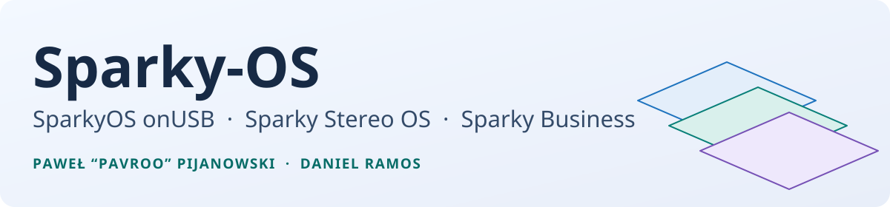
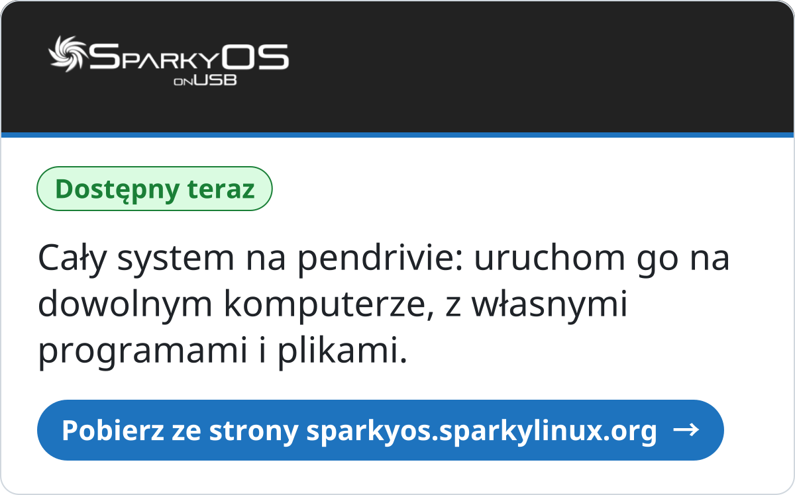
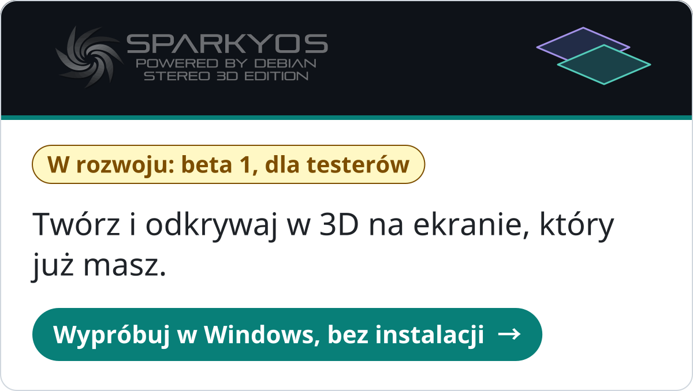

<picture>
  <source media="(prefers-color-scheme: dark)" srcset="./assets/banner-dark.svg">
  <source media="(prefers-color-scheme: light)" srcset="./assets/banner-light.svg">
  
</picture>

🇨🇦 [English](https://github.com/Sparky-OS) · 🇧🇷 [Português](https://github.com/Sparky-OS/.github/blob/main/profile/README.pt-BR.md) · 🇵🇱 [Polski](https://github.com/Sparky-OS/.github/blob/main/profile/README.pl.md) · 🇫🇷 [Français](https://github.com/Sparky-OS/.github/blob/main/profile/README.fr.md) · 🇩🇪 [Deutsch](https://github.com/Sparky-OS/.github/blob/main/profile/README.de.md) · 🇲🇽 [Español](https://github.com/Sparky-OS/.github/blob/main/profile/README.es.md) · 🇯🇵 [日本語](https://github.com/Sparky-OS/.github/blob/main/profile/README.ja.md) · 🇰🇷 [한국어](https://github.com/Sparky-OS/.github/blob/main/profile/README.ko.md) · 🇨🇳 [简体中文](https://github.com/Sparky-OS/.github/blob/main/profile/README.zh-CN.md) · 🇭🇰 [繁體中文](https://github.com/Sparky-OS/.github/blob/main/profile/README.zh-TW.md)

# Sparky-OS

**Trzy uzupełniające się systemy Linux: jeden działa z pendrive'a, który nosisz przy sobie, drugi pokazuje pulpit, filmy i gry w 3D na ekranie, który już masz, a trzeci jest dla małych firm.**
Tworzą je Paweł "pavroo" Pijanowski, twórca SparkyLinux, i Daniel Ramos.

## SparkyOS onUSB

<a href="https://sparkyos.sparkylinux.org/">
<picture>
  <source media="(prefers-color-scheme: dark)" srcset="./assets/cards/onusb-pl-dark.svg">
  <source media="(prefers-color-scheme: light)" srcset="./assets/cards/onusb-pl-light.svg">
  
</picture>
</a>

Cały system działa z pendrive'a i aktualizuje się jak system zainstalowany na dysku; na komputerze nic się nie instaluje.
Ma dwie edycje, jedną opartą na Arch Linux, drugą na Debianie, obie z lekkim pulpitem Xfce, dla 64-bitowych komputerów PC.
Autorzy: Paweł "pavroo" Pijanowski i zespół SparkyLinux (strona po angielsku): [strona projektu](https://sparkyos.sparkylinux.org/) · [Pobieranie](https://sparkyos.sparkylinux.org/download/) · [Poradniki (How-To)](https://sparkyos.sparkylinux.org/how-to/)

## Sparky Stereo OS

<a href="https://github.com/Sparky-OS/sparky-stereo-os/issues/27">
<picture>
  <source media="(prefers-color-scheme: dark)" srcset="./assets/cards/stereo-pl-dark.svg">
  <source media="(prefers-color-scheme: light)" srcset="./assets/cards/stereo-pl-light.svg">
  
</picture>
</a>

Maluj, edytuj zdjęcia i filmy, badaj cząsteczki i globusy, a potem oglądaj filmy i graj.
Powstał z myślą o każdym rodzaju ekranu 3D: telewizorach i projektorach 3D, zestawach VR, wyświetlaczach 3D bez okularów oraz dowolnym monitorze z okularami czerwono-cyjanowymi.
Na zwykłym monitorze 2D ten sam pulpit działa bez żadnych zmian.

 

*W okularach czerwono-cyjanowych zobaczysz te obrazy w 3D ([więcej](https://github.com/Sparky-OS/sparky-stereo-os/blob/main/docs/edition-in-detail.pl.md#seen-in-3d)).*

Sparky Stereo OS, edycja SparkyLinux autorstwa Daniela Ramosa (twórcą SparkyLinux jest Paweł "pavroo" Pijanowski), to system Linux z nowym pulpitem Stereo KDE Plasma.
Przetestowano na telewizorach 3D, na zwykłych monitorach z okularami czerwono-cyjanowymi i na telefonie z systemem Android w niedrogich goglach; wyświetlacze bez okularów i samodzielne zestawy są w toku.

**ISO dla deweloperów wysyłamy deweloperom na prośbę:** poproś o nie i opowiedz nam o swoim sprzęcie 3D, w swoim języku: [🇨🇦](https://github.com/Sparky-OS/sparky-stereo-os/issues/26) [🇧🇷](https://github.com/Sparky-OS/sparky-stereo-os/issues/25) [🇵🇱](https://github.com/Sparky-OS/sparky-stereo-os/issues/27) [🇫🇷](https://github.com/Sparky-OS/sparky-stereo-os/issues/80) [🇩🇪](https://github.com/Sparky-OS/sparky-stereo-os/issues/153) [🇲🇽](https://github.com/Sparky-OS/sparky-stereo-os/issues/351) [🇯🇵](https://github.com/Sparky-OS/sparky-stereo-os/issues/81) [🇰🇷](https://github.com/Sparky-OS/sparky-stereo-os/issues/83) [🇨🇳](https://github.com/Sparky-OS/sparky-stereo-os/issues/84) [🇭🇰](https://github.com/Sparky-OS/sparky-stereo-os/issues/85)

**Więcej:** [edycja](https://github.com/Sparky-OS/sparky-stereo-os/blob/main/README.pl.md) · [poradnik: wypróbuj w Windows](https://github.com/Sparky-OS/sparky-stereo-os/blob/main/docs/guides/try-on-windows.en.md) (po angielsku) · po angielsku: [co jest gotowe, szczegółowo](https://github.com/Sparky-OS/.github/blob/main/profile/in-detail.md#sparky-stereo-os) · [jak jest zbudowana](https://github.com/Sparky-OS/sparky-stereo-os/blob/main/docs/architectural-synthesis.md) · [nasze forki](https://github.com/Sparky-OS/.github/blob/main/profile/in-detail.md#repositories)

## Sparky Business: serwer i klient

<a href="https://github.com/Sparky-OS/.github/blob/main/profile/in-detail.md#business-editions">
<picture>
  <source media="(prefers-color-scheme: dark)" srcset="./assets/cards/business-pl-dark.svg">
  <source media="(prefers-color-scheme: light)" srcset="./assets/cards/business-pl-light.svg">
  
</picture>
</a>

Zaczęło się w 2018 roku od linii serwera i stacji roboczych dla małych firm.
Jego edycje serwerowa i kliencka, autorstwa Daniela Ramosa i Pawła Pijanowskiego, pojawią się po edycji stereo.
[Szczegółowo](https://github.com/Sparky-OS/.github/blob/main/profile/in-detail.md#business-editions) (po angielsku): czym jest i jego repozytoria.

## Ludzie

| | |
| --- | --- |
|  | **Daniel Ramos (Capitain Jack)** Inżynier elektryk, tworzy edycję stereo, a razem z Pawłem edycje biznesowe.   |
|  | **Paweł "pavroo" Pijanowski** Twórca SparkyLinux i SparkyOS onUSB; edycje stereo i biznesowe opierają się na narzędziach i wydaniach SparkyLinux.   |

**Opiekunowie pakietów**, każdy z pełnymi prawami do własnego repozytorium tutaj:

| | |
| --- | --- |
|  | **Eff (effcol)** Opiekuje się [wiz3D](https://github.com/effcol/wiz3D), uniwersalną nakładką stereoskopową 3D dla DirectX, OpenGL, AMD HD3D i NVIDIA 3D Vision, opartą na iZ3D, dla każdego systemu, oraz jej pakietem tutaj, [Sparky-OS/wiz3D](https://github.com/Sparky-OS/wiz3D).  |
|  | **Jeromy Streets (halverneus)** Stworzył i utrzymuje [org.kde.video](https://github.com/Sparky-OS/org.kde.video), tapetę wideo i ekran blokady dla KDE Plasma.  |
|  | **Pedro F. Albanese (pedroalbanese)** Razem z Danielem utrzymuje [Sparky CA](https://github.com/Sparky-OS/sparky-ca), narzędzie, które instaluje brazylijskie certyfikaty ICP-Brasil i dba o ich aktualność, oraz napisał [e521](https://github.com/pedroalbanese/e521), bibliotekę podpisów Ed521, których używa jeden z certyfikatów głównych ICP-Brasil.  |

## Repozytoria

[sparky-stereo-os](https://github.com/Sparky-OS/sparky-stereo-os) zawiera dokumenty, umiejętności (skills) i narzędzia edycji.
Każdy fork według dziedziny, repozytoria edycji biznesowych, narzędzia i grafika: [szczegółowo](https://github.com/Sparky-OS/.github/blob/main/profile/in-detail.md#repositories) (po angielsku).
Otwarte listy Daniela i powiązane forki: [powiązane prace](https://github.com/Sparky-OS/.github/blob/main/profile/in-detail.md#related-work) (po angielsku).

## Związek ze SparkyLinux

SparkyLinux to dystrybucja Pawła Pijanowskiego, a edycje stereo i biznesowe są na niej oparte.
Sparky Stereo OS jest edycją SparkyLinux, a nie jego zamiennikiem.
Narzędzia, repozytoria i nazwy wydań Sparky pozostają Pawła, a nasze pakiety od nich zależą, zamiast je kopiować.
[Szczegółowo](https://github.com/Sparky-OS/.github/blob/main/profile/in-detail.md#how-this-relates-to-sparkylinux) (po angielsku)

[SparkyLinux](https://sparkylinux.org) · [Wesprzyj SparkyLinux](https://sparkylinux.org/donate/) · [github.com/sparkylinux](https://github.com/sparkylinux) · [Daniel na GitHubie](https://github.com/danielcamposramos) · [Wesprzyj Daniela](https://github.com/sponsors/danielcamposramos)
