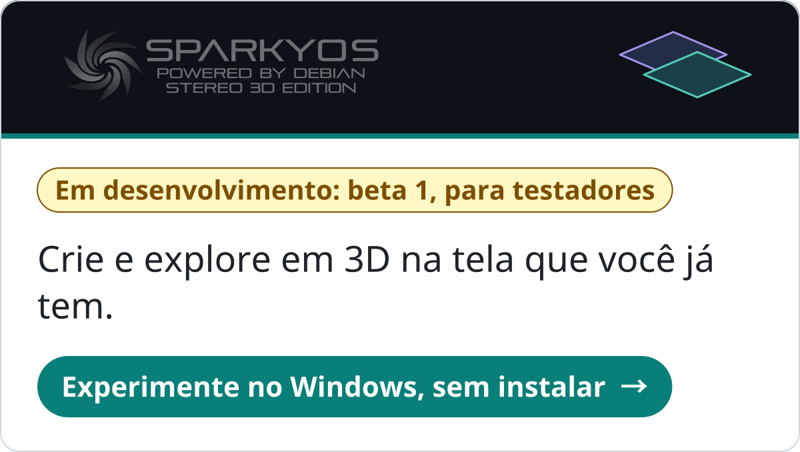

<picture>
  <source media="(prefers-color-scheme: dark)" srcset="./assets/banner-dark.svg">
  <source media="(prefers-color-scheme: light)" srcset="./assets/banner-light.svg">
  
</picture>

🇨🇦 [English](https://github.com/Sparky-OS) · 🇧🇷 [Português](https://github.com/Sparky-OS/.github/blob/main/profile/README.pt-BR.md) · 🇵🇱 [Polski](https://github.com/Sparky-OS/.github/blob/main/profile/README.pl.md) · 🇫🇷 [Français](https://github.com/Sparky-OS/.github/blob/main/profile/README.fr.md) · 🇩🇪 [Deutsch](https://github.com/Sparky-OS/.github/blob/main/profile/README.de.md) · 🇲🇽 [Español](https://github.com/Sparky-OS/.github/blob/main/profile/README.es.md) · 🇯🇵 [日本語](https://github.com/Sparky-OS/.github/blob/main/profile/README.ja.md) · 🇰🇷 [한국어](https://github.com/Sparky-OS/.github/blob/main/profile/README.ko.md) · 🇨🇳 [简体中文](https://github.com/Sparky-OS/.github/blob/main/profile/README.zh-CN.md) · 🇭🇰 [繁體中文](https://github.com/Sparky-OS/.github/blob/main/profile/README.zh-TW.md)

# Sparky-OS

**Três sistemas Linux que se complementam: um roda a partir de um pendrive que você leva consigo, outro mostra sua área de trabalho, filmes e jogos em 3D na tela que você já tem, e o terceiro é para pequenas empresas.**
Feitos por Paweł "pavroo" Pijanowski, criador do SparkyLinux, e por Daniel Ramos.

## SparkyOS onUSB

<a href="https://sparkyos.sparkylinux.org/">
<picture>
  <source media="(prefers-color-scheme: dark)" srcset="./assets/cards/onusb-pt-BR-dark.svg">
  <source media="(prefers-color-scheme: light)" srcset="./assets/cards/onusb-pt-BR-light.svg">
  
</picture>
</a>

O sistema inteiro roda a partir do pendrive e se atualiza como um sistema instalado num disco; nada é instalado no computador.
Há duas edições, uma baseada no Arch Linux e outra no Debian, ambas com o leve ambiente Xfce, para PCs de 64 bits.
De Paweł "pavroo" Pijanowski e da equipe do SparkyLinux (site em inglês): [a página do projeto](https://sparkyos.sparkylinux.org/) · [Download](https://sparkyos.sparkylinux.org/download/) · [Guias (How-To)](https://sparkyos.sparkylinux.org/how-to/)

## Sparky Stereo OS

<a href="https://github.com/Sparky-OS/sparky-stereo-os/blob/main/docs/guides/try-on-windows.pt-BR.md">
<picture>
  <source media="(prefers-color-scheme: dark)" srcset="./assets/cards/stereo-pt-BR-dark.svg">
  <source media="(prefers-color-scheme: light)" srcset="./assets/cards/stereo-pt-BR-light.svg">
  
</picture>
</a>

Pinte, edite fotos e vídeos, estude moléculas e globos, depois assista a filmes e jogue.
Ele é feito para todo tipo de tela 3D: TVs e projetores 3D, headsets de VR, telas 3D sem óculos e qualquer monitor com óculos vermelho e ciano.
Num monitor 2D comum, a mesma área de trabalho funciona sem nenhuma mudança.

 

*Óculos vermelho e ciano mostram essas imagens em 3D ([mais](https://github.com/Sparky-OS/sparky-stereo-os/blob/main/docs/edition-in-detail.pt-BR.md#seen-in-3d)).*

Sparky Stereo OS, a edição de Daniel Ramos do SparkyLinux (de Paweł "pavroo" Pijanowski), é um sistema Linux com uma nova área de trabalho Stereo KDE Plasma.
Testado em TVs 3D, em monitores comuns com óculos vermelho e ciano e em um celular Android num visor de baixo custo; as telas sem óculos e os headsets autônomos estão em desenvolvimento.

**Próximo passo: experimente no seu PC com Windows, pelo pendrive, sem instalar nada:** [uma página, dez passos](https://github.com/Sparky-OS/sparky-stereo-os/blob/main/docs/guides/try-on-windows.pt-BR.md).
 Peça o download e conte sobre seu equipamento 3D, no seu idioma: [🇨🇦](https://github.com/Sparky-OS/sparky-stereo-os/issues/26) [🇧🇷](https://github.com/Sparky-OS/sparky-stereo-os/issues/25) [🇵🇱](https://github.com/Sparky-OS/sparky-stereo-os/issues/27) [🇫🇷](https://github.com/Sparky-OS/sparky-stereo-os/issues/80) [🇩🇪](https://github.com/Sparky-OS/sparky-stereo-os/issues/153) [🇲🇽](https://github.com/Sparky-OS/sparky-stereo-os/issues/351) [🇯🇵](https://github.com/Sparky-OS/sparky-stereo-os/issues/81) [🇰🇷](https://github.com/Sparky-OS/sparky-stereo-os/issues/83) [🇨🇳](https://github.com/Sparky-OS/sparky-stereo-os/issues/84) [🇭🇰](https://github.com/Sparky-OS/sparky-stereo-os/issues/85)

**Mais:** [a edição](https://github.com/Sparky-OS/sparky-stereo-os/blob/main/README.pt-BR.md) · em inglês: [o que está pronto, em detalhe](https://github.com/Sparky-OS/.github/blob/main/profile/in-detail.md#sparky-stereo-os) · [como é construída](https://github.com/Sparky-OS/sparky-stereo-os/blob/main/docs/architectural-synthesis.md) · [nossos forks](https://github.com/Sparky-OS/.github/blob/main/profile/in-detail.md#repositories)

## Sparky Business: servidor e cliente

<a href="https://github.com/Sparky-OS/.github/blob/main/profile/in-detail.md#business-editions">
<picture>
  <source media="(prefers-color-scheme: dark)" srcset="./assets/cards/business-pt-BR-dark.svg">
  <source media="(prefers-color-scheme: light)" srcset="./assets/cards/business-pt-BR-light.svg">
  
</picture>
</a>

Começou em 2018 com uma linha de servidor e estações de trabalho para pequenas empresas.
Suas edições servidor e cliente, de Daniel Ramos e Paweł Pijanowski, vêm depois da edição estéreo.
[Em detalhe](https://github.com/Sparky-OS/.github/blob/main/profile/in-detail.md#business-editions) (em inglês): o que é e seus repositórios.

## Pessoas

| | |
| --- | --- |
|  | **Daniel Ramos (Capitain Jack)** Engenheiro eletricista, constrói a edição estéreo e, com Paweł, as edições empresariais.   |
|  | **Paweł "pavroo" Pijanowski** Criador do SparkyLinux e do SparkyOS onUSB; as edições estéreo e empresariais se apoiam nas ferramentas e versões do SparkyLinux.   |

**Mantenedores de pacotes**, cada um com plenos direitos sobre o próprio repositório aqui:

| | |
| --- | --- |
|  | **Eff (effcol)** Mantém o [wiz3D](https://github.com/effcol/wiz3D), o wrapper estereoscópico 3D universal para DirectX, OpenGL, AMD HD3D e NVIDIA 3D Vision, baseado no iZ3D, para todos os sistemas, e o pacote dele aqui, [Sparky-OS/wiz3D](https://github.com/Sparky-OS/wiz3D).  |
|  | **Jeromy Streets (halverneus)** Criou e mantém o [org.kde.video](https://github.com/Sparky-OS/org.kde.video), o papel de parede em vídeo e a tela de bloqueio para o KDE Plasma.  |
|  | **Pedro F. Albanese (pedroalbanese)** Mantém o [Sparky CA](https://github.com/Sparky-OS/sparky-ca) com Daniel, a ferramenta que instala os certificados ICP-Brasil e os mantém atualizados, e escreveu o [e521](https://github.com/pedroalbanese/e521), a biblioteca das assinaturas Ed521 que uma raiz ICP-Brasil usa.  |

## Repositórios

O [sparky-stereo-os](https://github.com/Sparky-OS/sparky-stereo-os) reúne os documentos, as skills e as ferramentas da edição.
Cada fork por área, os repositórios das edições empresariais, as ferramentas e a arte: [em detalhe](https://github.com/Sparky-OS/.github/blob/main/profile/in-detail.md#repositories) (em inglês).
As listas abertas de Daniel e forks relacionados: [trabalhos relacionados](https://github.com/Sparky-OS/.github/blob/main/profile/in-detail.md#related-work) (em inglês).

## Como isto se relaciona com o SparkyLinux

O SparkyLinux é a distribuição de Paweł Pijanowski, e as edições estéreo e empresariais se apoiam nele.
O Sparky Stereo OS é uma edição do SparkyLinux, não um substituto dele.
As ferramentas, os repositórios e os nomes de versão do Sparky continuam sendo de Paweł, e nossos pacotes dependem deles em vez de copiá-los.
[Em detalhe](https://github.com/Sparky-OS/.github/blob/main/profile/in-detail.md#how-this-relates-to-sparkylinux) (em inglês)

[SparkyLinux](https://sparkylinux.org) · [Doe ao SparkyLinux](https://sparkylinux.org/donate/) · [github.com/sparkylinux](https://github.com/sparkylinux) · [Daniel no GitHub](https://github.com/danielcamposramos) · [Patrocine Daniel](https://github.com/sponsors/danielcamposramos)
